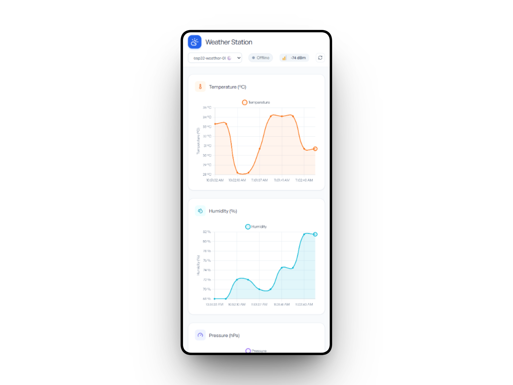
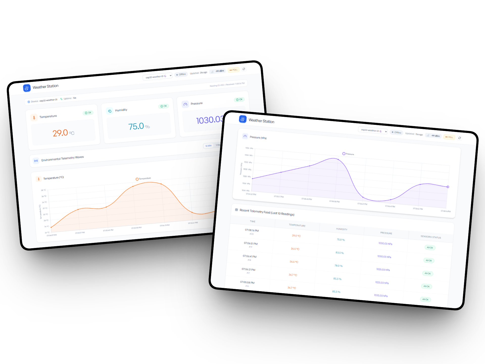
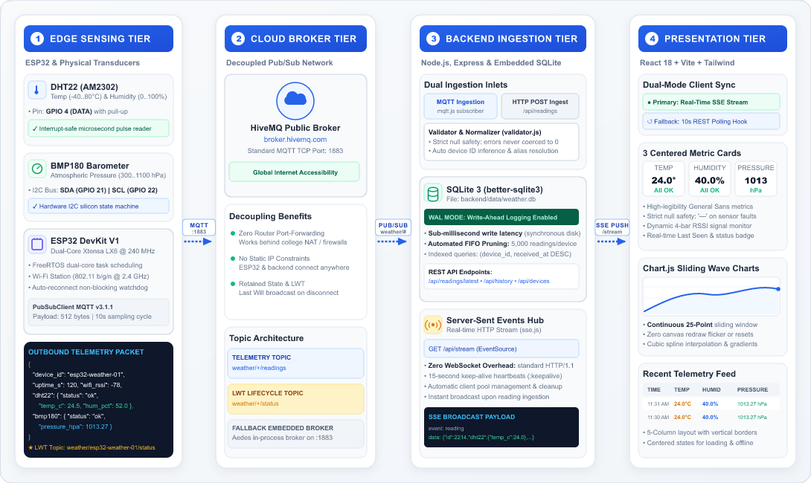

# IoT Weather Station Dashboard (MQTT & Real-Time Telemetry)

A full-stack, enterprise-grade IoT telemetry platform and weather station. Collects real-time temperature, humidity, and barometric pressure data from an ESP32 microcontroller using **MQTT** (port 1883), stores telemetry in an embedded SQLite database configured in Write-Ahead Logging (WAL) mode, and streams live metrics to a responsive React dashboard with real-time sliding Chart.js wave visualizations.

> 📊 **Project Presentation**: Slide deck available as [PDF](presentation/iot-weather-station.pdf) and [PowerPoint (PPTX)](presentation/iot-weather-station.pptx).

---

## Dashboard Preview



<br/><br/>



---

## System Architecture: Four Functional Tiers



The system is organized into four decoupled tiers, ensuring zero network-address-translation (NAT) friction, strict sensor null safety, sub-millisecond database writes, and zero WebSocket connection overhead:

### 1. Edge Sensing Tier (ESP32 & Physical Transducers)
- **ESP32 DevKit V1**: Dual-core Xtensa LX6 @ 240 MHz running FreeRTOS with non-blocking Wi-Fi and MQTT auto-reconnect watchdogs.
- **DHT22 (AM2302)**: Ambient temperature (-40..80°C) and relative humidity (0..100%) on digital pin **GPIO 4**. Employs an interrupt-safe, microsecond-accurate bit-banged pulse reader (`readDHT22()`) that eliminates timing timeouts without relying on blocking libraries.
- **BMP180 Barometer**: Atmospheric pressure (300..1100 hPa) on hardware I2C bus: **SDA (GPIO 21)** and **SCL (GPIO 22)** via internal silicon state machine.
- **Telemetry Ingestion Loop**: Formats telemetry into a 512-byte JSON packet and publishes it over MQTT every 10 seconds. Registers a **Last Will and Testament (LWT)** message on `weather/<device_id>/status` to immediately report disconnections.

### 2. Cloud Broker Tier (Decoupled Pub/Sub Network)
- **Public Cloud Broker**: Default connection to **HiveMQ** (`broker.hivemq.com:1883`), delivering global internet accessibility with zero router port-forwarding or static IP constraints. Operates reliably across private college networks and NAT firewalls.
- **Fallback In-Process Broker**: Embedded **Aedes MQTT broker** running on `:1883` for offline, local air-gapped deployments.
- **Topic Hierarchy**:
  - Ingestion: `weather/+/readings` (wildcard multi-device ingestion).
  - Lifecycle: `weather/+/status` (LWT online/offline broadcast).
  - Single-device legacy topic: `weather/readings`.

### 3. Backend Ingestion Tier (Node.js, Express & Embedded SQLite)
- **Dual Ingestion Inlets**: Ingests incoming data concurrently from the MQTT subscriber (`mqtt.js`) and the HTTP REST endpoint (`POST /api/readings`).
- **Strict Null Safety (`validator.js`)**: Normalizes and validates incoming payloads. Sensor timeouts or hardware faults preserve explicit `null` values and error flags instead of corrupting historical metrics as `0`.
- **SQLite 3 Engine (`better-sqlite3`)**: Runs in **Write-Ahead Logging (WAL)** mode for sub-millisecond synchronous disk writes and non-blocking reads. Automatically executes FIFO pruning to retain the latest 5,000 readings per device.
- **Server-Sent Events (SSE) Hub (`sse.js`)**: Broadcasts incoming readings instantly to web clients over `GET /api/stream` using standard HTTP/1.1 with 15-second keep-alive heartbeats, eliminating WebSocket handshake overhead.

### 4. Presentation Tier (React 18 + Vite + Tailwind CSS)
- **Dual-Mode Client Sync (`useLatestReading.js`)**: Browser-native `EventSource` establishes a live SSE pipeline, automatically falling back to 10-second REST polling if the connection drops.
- **Centered Metric Cards**: Minimalist, high-legibility cards for Temperature, Humidity, and Pressure with sensor status pills (`All OK` vs `Fault`). Strictly renders `—` when sensors report timeouts.
- **Dynamic Diagnostics**: Real-time 4-bar RSSI Wi-Fi signal monitor, device selector, Last Seen counter, and online/offline connectivity badges.
- **Sliding Wave Charts (`Chart.js`)**: Dynamic 25-point continuous sliding window with cubic spline interpolation, smooth curve animations, and dual area gradients without canvas flicker.
- **Telemetry Feed Table**: 5-column balanced table with vertical borders, human-readable timestamps, and screen-centered states for loading spinners and offline notifications.
- **Branded Design**: Includes custom `CloudSun` SVG favicon (`frontend/public/favicon.svg`) and matching header logo with `Weather Station` page metadata.

---

## Project Structure

```
iot-project/
├── images/                    # Architecture diagrams & UI screenshots
│   ├── architecture-diagram.png   # 1090 × 650 px architecture diagram
│   ├── architecture-diagram.svg   # Scalable vector graphics source
│   ├── architecture-diagram@2x.png# 2180 × 1300 px Retina diagram
│   ├── tablet_dashboard.png       # Tablet Dashboard Preview
│   └── mobile_dashboard.png       # Mobile Dashboard Preview
├── presentation/              # Project presentation slide deck
│   ├── iot-weather-station.pdf
│   └── iot-weather-station.pptx
├── backend/                   # Node.js + Express + SQLite + MQTT + SSE
│   ├── data/                  # Embedded SQLite database (weather.db, auto-created)
│   ├── scripts/
│   │   └── simulate.js        # Multi-sensor MQTT/HTTP telemetry simulator
│   ├── src/
│   │   ├── db.js              # SQLite schema, WAL mode, FIFO pruning & queries
│   │   ├── mqtt.js            # HiveMQ subscriber & embedded Aedes fallback broker
│   │   ├── sse.js             # Server-Sent Events hub & 15s heartbeats
│   │   ├── validator.js       # Payload normalization & strict null safety
│   │   └── server.js          # Express app, REST routes, SSE & MQTT wiring
│   ├── .env.example
│   ├── .gitignore
│   └── package.json
├── wokwi/                     # ESP32 firmware & Wokwi simulation
│   ├── sketch.ino             # ESP32 sketch with µs pulse timing (PubSubClient)
│   ├── diagram.json           # Wokwi circuit schematic wiring configuration
│   └── libraries.txt          # Microcontroller component libraries list
├── frontend/                  # React 18 + Vite + Tailwind CSS + Chart.js
│   ├── public/
│   │   └── favicon.svg        # Custom CloudSun weather station logo
│   ├── src/
│   │   ├── components/
│   │   │   ├── Header.jsx           # Device selector, online badge, RSSI monitor
│   │   │   ├── SensorCard.jsx       # Temperature, Humidity, Pressure metric cards
│   │   │   ├── StatusBadge.jsx      # Sensor OK vs Error fault badge
│   │   │   ├── WifiSignal.jsx       # 4-bar dynamic RSSI signal indicator
│   │   │   ├── HistoryCharts.jsx    # Real-time sliding Chart.js wave charts
│   │   │   └── ReadingsTable.jsx    # 5-column live telemetry feed
│   │   ├── hooks/
│   │   │   ├── useLatestReading.js  # SSE stream with 10s fallback polling
│   │   │   └── useHistory.js        # Historical queries & live sliding window
│   │   ├── config.js          # API base URL configuration
│   │   ├── App.jsx            # Centered layout, loader & main dashboard container
│   │   ├── main.jsx           # React DOM root
│   │   └── index.css          # Tailwind CSS styles & typography
│   ├── index.html             # Document metadata ("Weather Station" & favicon)
│   ├── vite.config.js
│   ├── tailwind.config.js
│   ├── postcss.config.js
│   ├── .env.example
│   ├── .gitignore
│   └── package.json
├── .gitignore
└── README.md
```

---

## Hardware Setup & Pinout

### Components
- **ESP32 DevKit V1** (Xtensa LX6 30-pin or 38-pin module)
- **DHT22 (AM2302)** Digital Temperature & Humidity Sensor
- **BMP180 (GY-68)** I2C Barometric Pressure Sensor
- Pull-up resistor (4.7kΩ – 10kΩ) for DHT22 data line (if using bare sensor)

### Wiring Table

| Transducer | Pin | ESP32 GPIO | Description / Protocol |
|---|---|---|---|
| **DHT22** | VCC | 3V3 / 5V | Sensor power |
| **DHT22** | DATA | **GPIO 4** | Single-bus bidirectional data (with 4.7kΩ pull-up) |
| **DHT22** | GND | GND | Ground reference |
| **BMP180** | VCC | 3V3 | Power (3.3V logic level) |
| **BMP180** | GND | GND | Ground reference |
| **BMP180** | SCL | **GPIO 22** | Hardware I2C Clock |
| **BMP180** | SDA | **GPIO 21** | Hardware I2C Data |

---

## Configuration & Environment Variables

### Backend (`backend/.env`)
Create `backend/.env` from `backend/.env.example`:
```env
# HTTP Port for Express REST & SSE (default: 3000)
PORT=3000

# MQTT Broker URL (default: mqtt://broker.hivemq.com:1883)
# To use the embedded in-process broker instead, set to "embedded"
MQTT_BROKER_URL=mqtt://broker.hivemq.com:1883

# Port used when running in embedded broker mode (default: 1883)
MQTT_PORT=1883

# Optional API key for authenticating POST /api/readings
API_KEY=
```

### Frontend (`frontend/.env`)
Create `frontend/.env` from `frontend/.env.example`:
```env
# Backend API base URL (default: http://localhost:3000)
VITE_API_URL=http://localhost:3000
```

---

## Quick Start Guide

### Step 1: Install Dependencies

```bash
# Install backend dependencies (Express, better-sqlite3, mqtt, aedes)
cd backend
npm install

# Install frontend dependencies (React, Vite, Tailwind, Chart.js)
cd ../frontend
npm install
```

---

### Step 2: Start the Backend Service

```bash
cd backend
npm run dev
```
*(Or run `npm start` for production).*
- Express REST API & SSE broadcaster runs at: **http://localhost:3000**
- MQTT subscriber automatically connects to **mqtt://broker.hivemq.com:1883** and subscribes to `weather/+/readings` and `weather/+/status`.

---

### Step 3: Start the Frontend Dashboard

In a second terminal:
```bash
cd frontend
npm run dev
```
Open **http://localhost:5173** in your web browser.

---

### Step 4: Stream Telemetry

#### Option A: Built-in Telemetry Simulator (No Hardware Needed)
In a third terminal:
```bash
cd backend
npm run simulate
```
The simulator publishes realistic fluctuating temperature, humidity, pressure, and RSSI telemetry to `weather/esp32-weather-01/readings` over MQTT every 5 seconds.

#### Option B: Flash ESP32 Microcontroller
1. Open [`wokwi/sketch.ino`](wokwi/sketch.ino) in Arduino IDE, PlatformIO, or Wokwi.
2. Install the required libraries via the Arduino Library Manager:
   - `PubSubClient` by Nick O'Leary
   - `Adafruit BMP085 Library` by Adafruit
3. Configure your Wi-Fi credentials in the sketch:
   ```cpp
   #define WIFI_SSID     "YOUR_WIFI_SSID"
   #define WIFI_PASSWORD "YOUR_WIFI_PASSWORD"
   #define MQTT_HOST     "broker.hivemq.com"
   #define MQTT_PORT     1883
   ```
4. Flash the sketch to your ESP32 board and open the Serial Monitor at **115200 baud**.

---

## Manual Telemetry Testing

### Via MQTT CLI (`mosquitto_pub`)
```bash
mosquitto_pub -h broker.hivemq.com -p 1883 -t "weather/esp32-weather-01/readings" -m '{
  "device_id": "esp32-weather-01",
  "uptime_s": 120,
  "wifi_rssi": -65,
  "dht22": { "status": "ok", "temperature_c": 24.5, "humidity_pct": 52.0 },
  "bmp180": { "status": "ok", "pressure_hpa": 1013.27 }
}'
```

### Via HTTP REST (`curl` / PowerShell)
```bash
curl -X POST http://localhost:3000/api/readings \
  -H "Content-Type: application/json" \
  -d '{
  "device_id": "esp32-weather-01",
  "uptime_s": 120,
  "wifi_rssi": -65,
  "dht22": { "status": "ok", "temperature_c": 24.5, "humidity_pct": 52.0 },
  "bmp180": { "status": "ok", "pressure_hpa": 1013.27 }
}'
```

```powershell
Invoke-RestMethod -Uri "http://localhost:3000/api/readings" -Method Post -ContentType "application/json" -Body '{"device_id":"esp32-weather-01","uptime_s":120,"wifi_rssi":-65,"dht22":{"status":"ok","temperature_c":24.5,"humidity_pct":52.0},"bmp180":{"status":"ok","pressure_hpa":1013.27}}'
```

---

## REST & Streaming API Reference

| Endpoint | Method | Description |
|---|---|---|
| `/api/health` | `GET` | Health check probe (`{ "ok": true }`) |
| `/api/readings` | `POST` | Ingests a new telemetry payload via HTTP |
| `/api/readings/latest?device_id=` | `GET` | Retrieves the most recent reading for a given device |
| `/api/readings?device_id=&limit=&from=&to=` | `GET` | Historical telemetry records (chronological order, max 1000) |
| `/api/devices` | `GET` | List of registered devices with last seen timestamp and online status |
| `/api/stream` | `GET` | Real-time Server-Sent Events (SSE) telemetry broadcast stream |

### Standard JSON Telemetry Format

```json
{
  "id": 2214,
  "device_id": "esp32-weather-01",
  "received_at": "2026-11-07T11:31:00.000Z",
  "uptime_s": 3600,
  "wifi_rssi": -68,
  "dht22": {
    "status": "ok",
    "temperature_c": 24.5,
    "humidity_pct": 52.0
  },
  "bmp180": {
    "status": "ok",
    "pressure_hpa": 1013.27,
    "temperature_c": 24.5
  }
}
```

---

## Production Build

To compile and bundle the React frontend for production deployment:

```bash
cd frontend
npm run build
```

The optimized static assets will be output to `frontend/dist/`.
