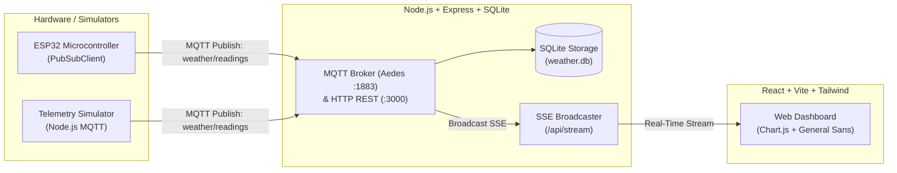

# IoT Weather Station Dashboard (MQTT & Real-Time Telemetry)

A full-stack IoT telemetry platform and weather station. Collects real-time temperature, humidity, and barometric pressure data from an ESP32 microcontroller (or simulator) using **MQTT** (port 1883), stores readings in an embedded SQLite database, and streams live telemetry to a responsive React dashboard with Chart.js visualizations.

---

## Architecture Overview



### Directory Structure

```
iot-project/
├── backend/                   # Node.js + Express + Aedes MQTT + better-sqlite3 + SSE
│   ├── data/                  # SQLite database (weather.db, auto-created)
│   ├── scripts/
│   │   └── simulate.js        # Realistic MQTT & HTTP telemetry simulator
│   ├── src/
│   │   ├── db.js              # SQLite schema, pruning & queries
│   │   ├── mqtt.js            # Embedded Aedes MQTT broker & external broker client
│   │   ├── sse.js             # Server-Sent Events hub & heartbeats
│   │   ├── validator.js       # Payload validation & alias normalization
│   │   └── server.js          # Express app & REST/SSE/MQTT endpoints
│   ├── .env.example
│   ├── .gitignore
│   └── package.json
├── firmware/                  # Microcontroller firmware
│   └── weather_station.ino    # ESP32 Arduino C++ sketch (MQTT PubSubClient)
├── frontend/                  # React + Vite + Tailwind CSS + Chart.js
│   ├── src/
│   │   ├── components/
│   │   │   ├── Header.jsx           # Device selector, online badge, RSSI signal
│   │   │   ├── SensorCard.jsx       # Temperature, Humidity, Pressure metric cards
│   │   │   ├── StatusBadge.jsx      # Sensor OK vs Error badge
│   │   │   ├── WifiSignal.jsx       # 4-bar RSSI signal strength indicator
│   │   │   ├── HistoryCharts.jsx    # Real-time sliding Chart.js telemetry charts
│   │   │   └── ReadingsTable.jsx    # Centered, equally-spaced recent readings feed
│   │   ├── hooks/
│   │   │   ├── useLatestReading.js  # SSE stream with 10s fallback polling
│   │   │   └── useHistory.js        # Historical queries & live sliding updates
│   │   ├── config.js          # Global API base URL configuration
│   │   ├── App.jsx            # Main dashboard container
│   │   ├── main.jsx           # React DOM root
│   │   └── index.css          # Tailwind CSS styles & General Sans typography
│   ├── index.html
│   ├── vite.config.js
│   ├── tailwind.config.js
│   ├── postcss.config.js
│   ├── .env.example
│   ├── .gitignore
│   └── package.json
├── .gitignore                 # Root repository ignore rules
└── README.md
```

---

## Features

- **Primary Transport - MQTT**:
  - Embedded **Aedes MQTT Broker** running on standard port `1883` out of the box — zero external tools or Mosquitto installations required.
  - Standard telemetry topic: `weather/readings` (or `weather/<device_id>/telemetry`).
  - Supports external MQTT brokers (e.g., Mosquitto, EMQX, HiveMQ) by simply setting `MQTT_BROKER_URL` in `.env`.
  - HTTP `POST /api/readings` remains active as a simultaneous fallback.
- **Active Sensors**:
  - **DHT22**: Ambient Temperature (°C) and Relative Humidity (%).
  - **BMP180**: Barometric Atmospheric Pressure (hPa).
- **Strict Null Safety**: When a sensor reports a hardware fault or timeout, numeric readings remain `null` and display as `—` rather than corrupting data as `0`.
- **High-Performance Storage**: Embedded SQLite database (`better-sqlite3`) configured with Write-Ahead Logging (`WAL`) mode and automatic per-device pruning (retains latest 5,000 readings).
- **Real-Time Streaming**: Server-Sent Events (`GET /api/stream`) with 15-second heartbeat keep-alives and automatic fallback to 10-second polling if disconnected.
- **Sliding Window Charts**: Continuous sliding wave charts powered by Chart.js with smooth curves and gradient fills, dynamically tracking the latest 25 readings.
- **Clean Minimalist Dashboard**: Pure light design, General Sans typography (`font-normal`), centered card metrics, and equally-spaced table columns with vertical grid dividers.
- **Hardware Firmware Included**: Production-ready Arduino C++ sketch for ESP32 with automatic Wi-Fi and MQTT reconnection, sensor error handling, and JSON telemetry publication.

---

## Hardware Setup & Pinout

### Components
- **ESP32 DevKit V1** (or compatible ESP32 board)
- **DHT22** (AM2302) Temperature & Humidity Sensor
- **BMP180** (or BMP085) I2C Barometric Pressure Sensor
- Pull-up resistor (4.7kΩ – 10kΩ) for DHT22 data line (if not using a 3-pin modular board)

### Wiring Diagram

| Sensor | Sensor Pin | ESP32 GPIO | Notes |
|---|---|---|---|
| **DHT22** | VCC | 3V3 / 5V | Powers the sensor |
| **DHT22** | DATA | GPIO 4 | Digital input (requires pull-up to 3V3) |
| **DHT22** | GND | GND | Ground |
| **BMP180** | VCC | 3V3 | Power (3.3V recommended) |
| **BMP180** | GND | GND | Ground |
| **BMP180** | SCL | GPIO 22 | I2C Clock |
| **BMP180** | SDA | GPIO 21 | I2C Data |

---

## Configuration & Environment Variables

### Backend (`backend/.env`)
Copy `backend/.env.example` to `backend/.env`:
```env
# HTTP Port for Express REST & SSE (default: 3000)
PORT=3000

# MQTT Broker URL (default: mqtt://broker.hivemq.com:1883 matching firmware)
# Set to "embedded" to run an in-process local broker on MQTT_PORT instead
MQTT_BROKER_URL=mqtt://broker.hivemq.com:1883

# Port used when running in embedded broker mode (default: 1883)
MQTT_PORT=1883

# Optional API key for securing POST /api/readings
API_KEY=
```

### Frontend (`frontend/.env`)
Copy `frontend/.env.example` to `frontend/.env`:
```env
# Backend API base URL (default: http://localhost:3000)
VITE_API_URL=http://localhost:3000
```

---

## Quick Start Guide

### Step 1: Install Dependencies

From the repository root:

```bash
# Install backend dependencies (Express + SQLite + MQTT + SSE)
cd backend
npm install

# Install frontend dependencies (React + Vite + Chart.js)
cd ../frontend
npm install
```

---

### Step 2: Start the Backend (API + MQTT Bridge)

```bash
cd backend
npm run dev
```
*(Or `npm start` for production mode).*
- The HTTP server starts at **http://localhost:3000**.
- The MQTT client automatically connects to **mqtt://broker.hivemq.com:1883** and subscribes to:
  - `weather/+/readings`
  - `weather/+/status`
  - `weather/readings`

---

### Step 3: Start the Frontend Dashboard

In a second terminal:

```bash
cd frontend
npm run dev
```
Open **http://localhost:5173** in your web browser.

---

### Step 4: Transmit Telemetry

You can stream data to the platform using any of the following methods:

#### Option A: Run the Built-in MQTT Simulator (No Hardware Required)
In a third terminal:
```bash
cd backend
npm run simulate
```
The simulator connects to the HiveMQ broker and publishes JSON telemetry to `weather/esp32-weather-01/readings` every 5 seconds.

#### Option B: Flash ESP32 Hardware Firmware
1. Open [`firmware/weather_station.ino`](firmware/weather_station.ino) in Arduino IDE or PlatformIO.
2. Install the required Arduino libraries via Library Manager:
   - `PubSubClient` by Nick O'Leary
   - `DHT sensor library for ESPx` by beegee-tokyo
   - `Adafruit BMP085 Library` by Adafruit
3. Set your Wi-Fi credentials:
   ```cpp
   #define WIFI_SSID     "YOUR_WIFI_SSID"
   #define WIFI_PASSWORD "YOUR_WIFI_PASSWORD"
   #define MQTT_HOST     "broker.hivemq.com"
   #define MQTT_PORT     1883
   ```
4. Upload to your ESP32 board and open the Serial Monitor at `115200` baud.

---

## Testing MQTT Manually

### Using Mosquitto CLI
If you have `mosquitto_pub` installed:
```bash
mosquitto_pub -h localhost -p 1883 -t "weather/readings" -m '{
  "device_id": "esp32-weather-01",
  "uptime_s": 120,
  "wifi_rssi": -52,
  "dht22": { "status": "ok", "temperature_c": 24.2, "humidity_pct": 58.4 },
  "bmp180": { "status": "ok", "pressure_hpa": 1013.25 }
}'
```

### Using HTTP POST (`curl` / PowerShell Fallback)
The backend also accepts readings directly over HTTP:
```bash
curl -X POST http://localhost:3000/api/readings \
  -H "Content-Type: application/json" \
  -d '{
  "device_id": "esp32-weather-01",
  "uptime_s": 120,
  "wifi_rssi": -52,
  "dht22": { "status": "ok", "temperature_c": 24.2, "humidity_pct": 58.4 },
  "bmp180": { "status": "ok", "pressure_hpa": 1013.25 }
}'
```

```powershell
Invoke-RestMethod -Uri "http://localhost:3000/api/readings" -Method Post -ContentType "application/json" -Body '{"device_id":"esp32-weather-01","uptime_s":120,"wifi_rssi":-52,"dht22":{"status":"ok","temperature_c":24.2,"humidity_pct":58.4},"bmp180":{"status":"ok","pressure_hpa":1013.25}}'
```

---

## API Reference

| Endpoint | Method | Description |
|---|---|---|
| `/api/health` | `GET` | Health check (`{ "ok": true }`) |
| `/api/readings` | `POST` | Ingests a new sensor reading payload via HTTP |
| `/api/readings/latest?device_id=` | `GET` | Returns the most recent reading for a device |
| `/api/readings?device_id=&limit=&from=&to=` | `GET` | Historical readings list (oldest to newest, max 1000) |
| `/api/devices` | `GET` | List of registered devices with last seen timestamp and online status |
| `/api/stream` | `GET` | Server-Sent Events stream for live real-time dashboard updates |

### Sample JSON Telemetry Payload

```json
{
  "id": 142,
  "device_id": "esp32-weather-01",
  "received_at": "2026-11-06T00:20:00.000Z",
  "uptime_s": 3600,
  "wifi_rssi": -55,
  "dht22": {
    "status": "ok",
    "temperature_c": 24.5,
    "humidity_pct": 52.1
  },
  "bmp180": {
    "status": "ok",
    "pressure_hpa": 1014.2,
    "temperature_c": 24.5
  }
}
```

---

## Production Build

To build the frontend for production deployment:

```bash
cd frontend
npm run build
```

The compiled assets will be output to `frontend/dist/`.
